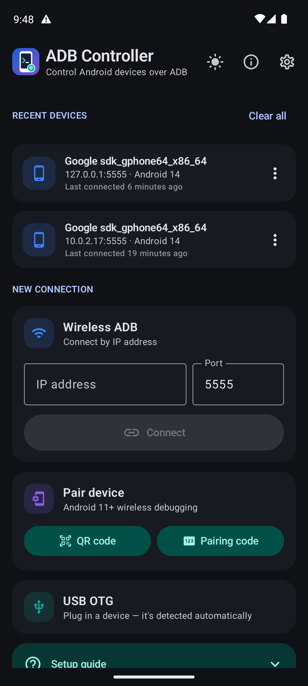
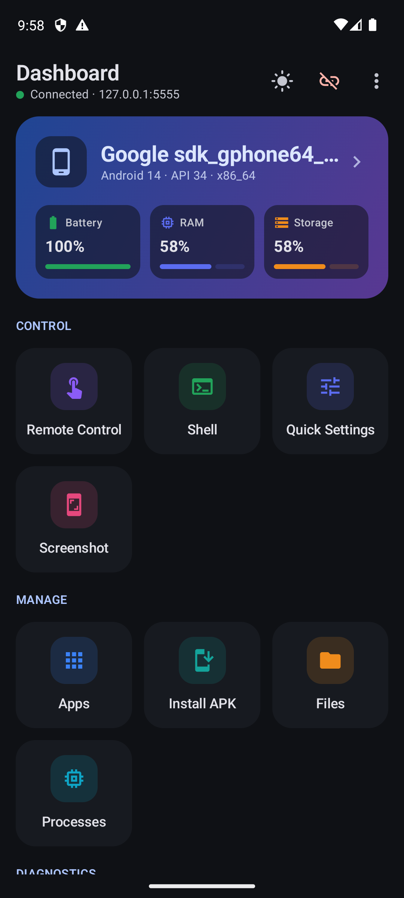
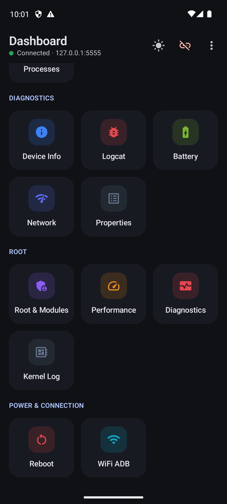
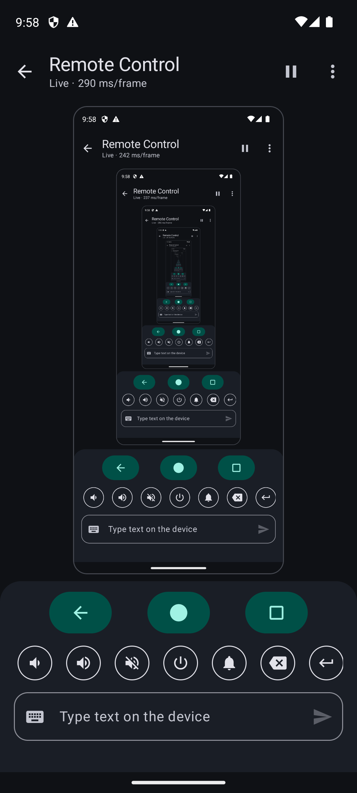
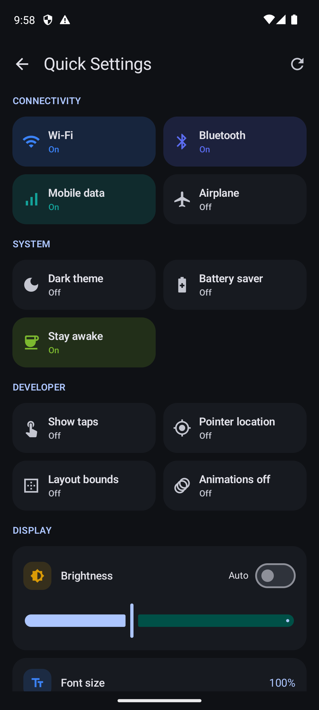
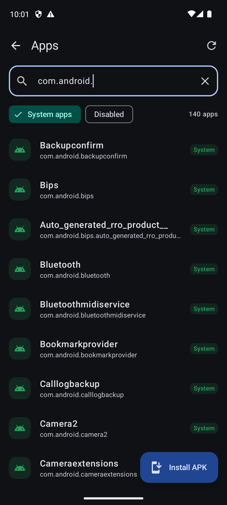
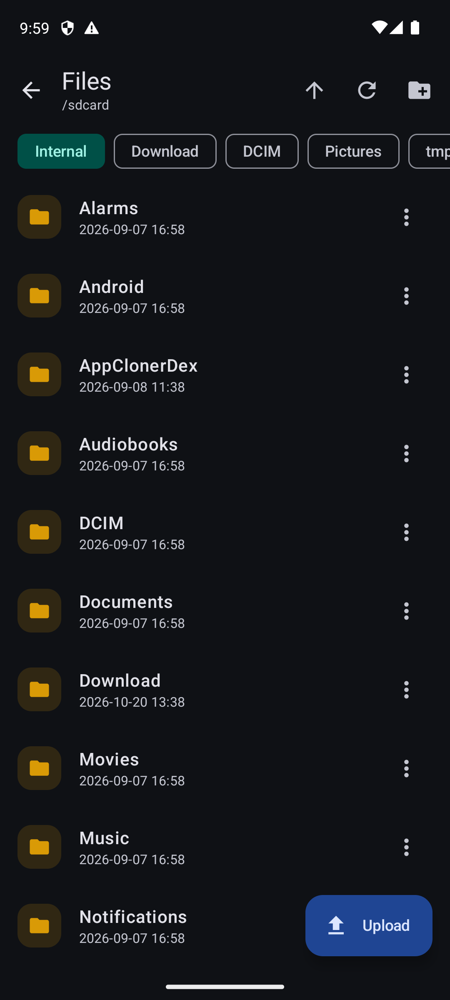
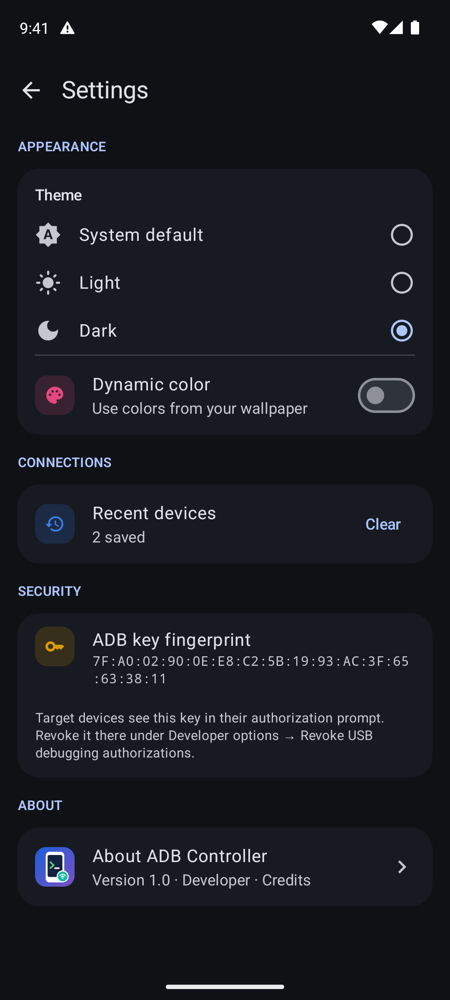
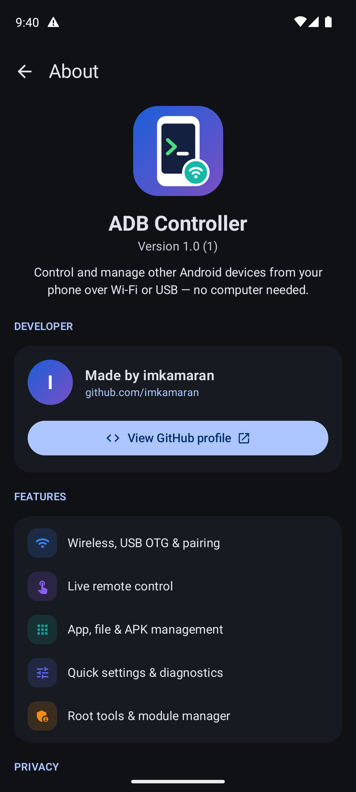

# ADB Controller

[](LICENSE)


Control and manage other Android devices **from your Android phone** — over Wi-Fi or a USB OTG cable, no computer needed. ADB Controller speaks the ADB protocol natively, so every action is a button instead of a shell command.

## Screenshots

Captured while connected to a device at `127.0.0.1:5555` (an emulator controlling its own ADB daemon).

| Home | Dashboard | Dashboard tools |
|:---:|:---:|:---:|
|  |  |  |
| **Remote control** | **Quick settings** | **Apps** |
|  |  |  |
| **Files** | **Settings** | **About** |
|  |  |  |

## Features

**Connecting**
- Wireless ADB by IP and port, with a list of recent devices (model, Android version, last connected; rename or remove)
- USB OTG — devices are detected automatically when plugged in
- Android 11+ wireless-debugging pairing (**experimental**): pair with a 6-digit code (devices on your network are found automatically), pair by showing a QR code for the target to scan, or pair this phone with itself by entering the code in a notification, like Shizuku. Connecting after pairing isn't reliable yet; the dependable Wi-Fi route is to connect once by USB OTG and use **WiFi ADB**, or `adb tcpip 5555`

**Control**
- Live remote control — see the screen, tap, long-press and swipe; navigation, volume and power keys; type text; open URLs
- Shell terminal with quick commands
- Quick settings — Wi-Fi, Bluetooth, mobile data, airplane mode, dark theme, battery saver, stay awake, show taps, layout bounds, animations, brightness, font size, screen timeout, resolution and DPI
- Screenshots, saved to your phone

**Management**
- Apps — search, launch, force stop, clear data, enable/disable, uninstall, view details, extract APK, manage runtime permissions
- Install APKs from your phone with upload progress
- File manager — browse, upload, download, rename, delete, install APKs on the device

**Diagnostics**
- Device info (battery, RAM, storage, CPU, uptime), logcat with level filters, processes, network, battery, system properties, kernel log

**Rooted devices** (Magisk / KernelSU / APatch)
- Root status, manager and version, SELinux mode
- Module manager — enable/disable, remove/restore, install from zip, run module actions, enable/disable all
- Root shell and root file browser
- Performance — per-core CPU governor and frequency, temperatures, ZRAM
- Diagnostics — crash (tombstone) and ANR reports, wakelocks, battery-stats reset
- Soft reboot and SystemUI restart

**App**
- Light, dark and system themes, plus Material You dynamic color on Android 12+
- No accounts, analytics or cloud services

## Building

Requirements: JDK 17+ and the Android SDK (API 36).

```bash
./gradlew assembleDebug
```

The APK is written to `app/build/outputs/apk/debug/app-debug.apk`. On Windows, `build-app.ps1` builds, installs and launches it on a connected device or emulator.

Debug builds install as **ADB Controller (debug)** (`com.adbcontroller.debug`), so they can sit alongside the release version from [Releases](https://github.com/imkamaran/AdbController/releases).

### "App not installed" when installing a release

Android won't update an app that was signed with a different key. If you previously installed a build of ADB Controller made before v1.0.1's debug-package change (for example one built from source), uninstall it first, then install the release APK.

## Using it

1. On the target device, enable **Developer options** and **USB debugging**.
2. Connect:
   - **USB:** plug the device into your phone with an OTG cable.
   - **Wi-Fi:** connect once over USB and use **WiFi ADB** on the dashboard, or run `adb tcpip 5555` from a computer, then enter the device's IP address.
3. Approve the **Allow USB debugging?** prompt on the target. The fingerprint shown there matches the one under **Settings → Security** in the app.

## Tech stack

Kotlin, Coroutines, Jetpack Compose, Material 3, AndroidX Navigation, ZXing and Bouncy Castle. The ADB protocol (transport, authentication, streams and file sync) is implemented from scratch in `app/src/main/java/com/adbcontroller/adb`. Wireless-debugging pairing uses [libadb-android](https://github.com/MuntashirAkon/libadb-android) (GPL-3.0-or-later / Apache-2.0) with Conscrypt.

## Contributing

Contributions are welcome! Please read [CONTRIBUTING.md](CONTRIBUTING.md) before opening a pull request. All commits must be signed off (`git commit -s`), and contributions are accepted under the project's GPL-3.0 license.

## Disclaimer

ADB Controller is intended for managing devices that you own or are explicitly authorized to administer. Actions such as rebooting, uninstalling apps, changing system settings or modifying root modules can cause data loss or make a device unstable. Use them at your own risk. The software is provided without warranty, as described in the license.

## License

Copyright (C) 2026 [imkamaran](https://github.com/imkamaran)

This program is free software: you can redistribute it and/or modify it under the terms of the GNU General Public License as published by the Free Software Foundation, version 3 of the License.

This program is distributed in the hope that it will be useful, but WITHOUT ANY WARRANTY; without even the implied warranty of MERCHANTABILITY or FITNESS FOR A PARTICULAR PURPOSE. See the [GNU General Public License](LICENSE) for more details.
